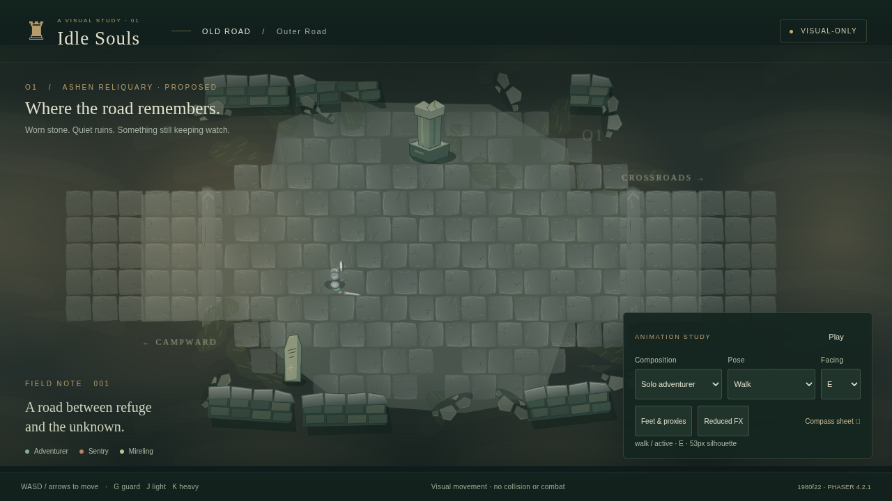

# Old Road visual production delivery

2026-10-23 · branch `feat/old-road-visual-proof` · runtime evidence build `1980f22`.

This is the first standalone **visual-only** playable workbench. Move the adventurer with keyboard/touch, compare eight facings and action poses, isolate either enemy, and inspect the assembled Old Road at desktop and phone viewports. It does not simulate fights, navigation/collision, banking, keys or campaign outcomes. No combat AI was copied or invented.



## Commits and milestone scope

| Commit | Increment |
|---|---|
| `be6597d` | V0 Phaser 4.2.1, TypeScript/Vite, readonly presentation contract, deterministic tests, repository instructions |
| `72dae85` | V1 modular editable Old Road environment and painted-vector effect masters |
| `2983271` | V2 fixed +75° camera, asymmetric mannequin, editable rig and stable-anchor export/packing scripts |
| `9d378c1` | V3 adventurer source, 113 frames, eight locomotion/guard facings, phase samples and isolated visual fixture |
| `4905051` | V4 Sentry/Mireling sources and poses, responsive Old Road playback, compass/recognition/attack boards, automated checks |
| `5e41ee8` | Explicit world-feet labels, independent proxy bounds, robust production screenshot capture |
| `8e8b6ca` | Landscape camera follows the adventurer inside the visible safe area |
| `1980f22` | Attack pose selects the supplied action phase independently of unequal move durations |

V0 and the technical V2 pipeline gates pass. V1/V3/V4 are **reviewable art proofs**, not creator-approved final art or combat truth signoff. V5 is **BLOCKED**. The starting repository at `eaf4475` contained documentation/maps only; no combat implementation or earlier geometric Phaser/RUN preview existed. Remote main still pointed to this baseline at the final check. Main simulation versus deep-stats lineage has not been selected, and no seeded replay baseline is available.

## Preview and reproduction

From repository root: `npm ci && npm run dev`; open http://localhost:5173. `npm run build && npm run preview` serves the production bundle at http://localhost:4173. Node 22.12+ is required.

WASD/arrows or touch arrows move the **visual** adventurer; G guard, J light, K heavy, Space animation pause. Composition/pose/facing menus support isolated and combined tests. Feet/proxy and Reduced FX controls have at least 44px hit heights at tested viewports. Portrait and landscape cameras preserve subject size rather than shrinking the complete diorama. These controls are an art bench, not player orders or tactical microcontrol for the eventual autonomous RPG.

Useful URLs:

- `/?composition=traversal&action=walk&facing=E&t=.95` — deterministic traversal still.
- `/?debug&action=guard&t=.95` — fixed feet/world coordinates, r13 **proposed** body proxy and independent cover outlines.
- `/?scene=calibration` — four actors × eight compass headings; no sprite reflection.
- `/?scene=silhouette` — unlabeled bright/dark actor samples.
- `/?scene=attacks&actor=adventurer&clip=light` — eight requested headings, three phases; unauthored views explicitly labelled.
- `/?floor=dark&action=guard&t=.95` — same actors on darker environmental values.

`npm run evidence` against the production preview captures screenshots, viewport/camera zoom, build SHA, resource responses and cloud timing. `PREVIEW_URL` and `CHROMIUM_PATH` are optional overrides. See [README](../../README.md) for browser setup and asset commands.

Asset source regeneration:

```sh
python -m pip install -r tools/requirements.txt
npm run assets:environment
npm run assets:characters
npm run assets:atlas
npm run assets:validate
blender -b -t 4 --python tools/blender/validate.py
npm run assets:reproduce
```

Blender 4.3.2 / Python 3.12 were used. `assets:characters` renders the **retained .blend masters**, including manual edits. `assets:characters:rebuild` intentionally overwrites those masters using the construction script. Intermediate PNG sequences are derivable and ignored. Runtime exports are checked in; Blender is not a runtime dependency. Only runtime PNGs/atlas JSON enter `dist`, not sources or render caches.

## Camera, anchoring and coverage

[Source validation](source-validation.json) measures all four cameras at **74.99999988° elevation**, orthographic scale **5.4**, azimuth **−90°**. World ground is XY, +Z up, actor forward +Y. Actor yaw rotates −45° per compass step; camera/light configuration stays stationary. Ground origin projects to **(96,96)** in each 192×192 source canvas. Runtime scale .63 gives 22.4 world units per Blender unit; these numeric defaults are reversible proposals, not additional locks.

All 335 frames passed source-canvas clipping and pixel-exact trim reconstruction. Phaser restores the common source canvas before applying its .5/.5 origin. Draw depth uses feet Y, never the sword's alpha bounds. The r13 overlay is a documented future body reference, **not implemented collision**, and never derives from sprite size. [Atlas validation](atlas-validation.json), [reproduction hashes](reproducibility.json) and [per-frame metadata](../../assets/characters/runtime/adventurer.metadata.json) record the evidence. A fresh render of the retained adventurer guard NE source frame reproduces identical decoded RGBA pixels; PNG container metadata can differ.

| Actor | Frames | Idle / locomotion / guard | Attack proof |
|---|---:|---|---|
| Mannequin | 64 | 8 idle; 8×4 walk; 8×3 guard | Calibration only |
| Adventurer | 113 | 8 idle; 8×4 walk; 8×3 guard | Light N/NE/E/S/SW ×3; heavy all 8 ×3; dodge/reaction one pose at 5 headings |
| Ashen Sentry | 94 | 8 idle; 8×4 walk; 8×3 guard | Slash and bash N/NE/E/S/SW ×3 |
| Mireling | 64 | 8 idle; 8×4 walk; no invented guard | Coil/leap/recovery all 8 ×3 |

Attack direction sets are per-move trials. Heavy and leap conservatively receive all eight because overhead blade depth and directional launch are sensitive; slash/bash use the initial five-view stress set. [Direction review](direction-review.csv) lists every requested heading. Missing selective attack views draw **no attack cue**, show same-heading idle and display “view unavailable”; there is no approved directional fallback. All actual-simulation heading/geometry checks remain blocked until authoritative data exists.

Exhibition timing is deliberately slow for inspection. Future adapters supply action phase/tick/progress and visibility. The renderer maps supplied windup/active/recovery to the corresponding pose; it does not divide real combat duration into equal thirds or emit hits. Guard sparks and strike/landing effects are **labelled art samples**, not confirmed contacts, hitboxes or invulnerability claims.

## Evidence board

All engine captures come from the same asset set and build. [Capture manifest](capture-manifest.json) gives exact URLs, viewport, camera zoom, build ID and response errors. No gameplay screenshot was generated by an image model. Grayscale and approximate full-severity protanopia/deuteranopia previews use documented browser CSS/SVG transforms; they do not constitute human accessibility validation.

| Evidence | Captures |
|---|---|
| S01 traversal, desktop 1280×720 | [Establishing view](screenshots/S01-old-road.png) |
| S02 solo Mireling | [Coil](screenshots/S02-mireling-coil.png), [leap](screenshots/S02-mireling-leap.png) |
| S03 solo Sentry | [Guard and spark sample](screenshots/S03-sentry-guard.png) |
| S04 light phases | [Windup](screenshots/S04-light-windup.png), [active pose](screenshots/S04-light-active.png), [recovery](screenshots/S04-light-recovery.png) |
| S04 heavy / bash | [Windup](screenshots/S04-heavy-windup.png), [active pose](screenshots/S04-heavy-active.png), [recovery](screenshots/S04-heavy-recovery.png), [Sentry bash](screenshots/S04-sentry-bash.png) |
| S05 mixed / vision simulations | [Mixed](screenshots/S05-mixed.png), [protanopia](screenshots/S05-protanopia.png), [deuteranopia](screenshots/S05-deuteranopia.png) |
| S06 responsive | [390×844 portrait](screenshots/S06-portrait.png), [844×390 landscape](screenshots/S06-landscape.png) |
| Feet and collision proxies | [Overlay](screenshots/S07-pivots-proxies.png) |
| Eight-heading rig/actor boards | [Engine compass](screenshots/S08-compass.png), [mannequin move/guard](mannequin-compass.png), [adventurer move/guard](adventurer-compass.png), [Sentry](sentry-compass.png), [Mireling](mireling-compass.png) |
| Bright/dark values | [Unlabeled grayscale sheet](screenshots/S09-recognition-grayscale.png), [dark-floor scene](screenshots/S10-dark-floor.png) |
| Additional desktop | [1920×1080](screenshots/S11-1920-desktop.png) |
| All requested attack headings | [Light](screenshots/S12-light-directions.png), [heavy](screenshots/S12-heavy-directions.png), [bash](screenshots/S12-bash-directions.png), [leap](screenshots/S12-leap-directions.png) |

## Verification and asset budget

- `npm run lint` — PASS.
- `npm run typecheck` — PASS.
- `npm test` — **7 tests PASS**, including all eight direction sets, stable trim pivots, missing attack behavior and unequal-duration phase selection.
- `npm run build` — PASS, pinned Phaser 4.2.1 APIs verified against installed package.
- `npm run test:browser` — **4 scenarios PASS**, exercising 1280×720, 390×844, 844×390, real controls, movement, visibility, no mirroring, explicit missing views and 32-entry engine compass.
- `python tools/atlas/validate.py` — PASS, **335/335** exact source/atlas pixels, anchors and clipping margins.
- Retained-source full re-export — all **335** frames matched the earlier packed pixels before repacking.
- Blender source validation — PASS for four cameras/rigs, bone-parented meshes, named actions and ground origins.
- `npm run assets:reproduce` — PASS, retained `.blend` sample exact decoded-pixel equality.

[Atlas report](../../assets/characters/runtime/atlas-report.json): four character textures, two 1024×1024 and two 1024×512; **12 MiB** estimated decoded RGBA texture allocation; **1,814,694 bytes** total character PNG transfer payload. This excludes environment textures, framebuffers, browser overhead and optional loading optimizations. Mannequin is currently loaded even in the Old Road view. Main JavaScript is approximately **1.383 MB / 363 kB gzip**. A gzip-capable host is needed for compressed delivery.

[Cloud performance](capture-manifest.json) records a 119-interval headless Chromium/ANGLE SwiftShader sample. This software renderer was slow; exact median/p95 are recorded in the JSON. It is **not a hardware GPU or physical phone benchmark**, and no 60 FPS/mobile claim is made. Lower-end Android, GPU memory and battery/thermal behavior remain NOT TESTED.

[Review matrix](review-matrix.csv) maps original 29B and 30B checks to **PASS / FAIL / BLOCKED / NOT TESTED**. [Asset delivery](asset-delivery.csv) accounts for the original 29A queue, including missing/deferred variants. Original design planning CSVs were preserved rather than falsely marked complete. No source-level replay parity report is fabricated.

## Known limitations and approval status

- **Combat V5 blocked:** creator/current combat owner must select the main simulation versus deep-stats split and provide real source + baseline seeded events. No AI, damage, stamina, iframes, hitbox, move timing, doctrine or enemy-selection logic has been implemented here.
- Wall/pillar art is separated from proposed proxies; movement, projectile collision, LOS, fog and cutaway integration are unimplemented. Visual movement can cross art. There are no functional world exits or strategic orders.
- Models are editable **10-bone, rigid-part prototype rigs** with broad-plane Workbench materials. Four gait samples and three attack poses demonstrate the pipeline; they are not finished natural animation. Full death/retreat clips, refined lower-limb controls, sockets and artist paintover are deferred.
- Environment/VFX use original hand-authored layered vector-paint masters. These are a reversible material/composition test and would benefit from freehand finishing. Wall corner/cutaway variants, richer transitions, standalone crack/weed variants and other 29A assets are partial or missing.
- Three unfamiliar-viewer recognition, creator rubric, critical-text contrast measurement and real phone testing remain outstanding. The Sentry/hero grayscale distinction particularly needs that review; technical correctness does not approve their final silhouettes.
- **Ashen Reliquary, palette, proportions, source frame size, zoom, camera azimuth and attack direction lists remain PROPOSED.** No changes to locked decision register 16, combat rules or world/economy promises were made. No further roster/region art was mass-produced.

**Highest-value next implementation milestone:** connect a creator-selected authoritative combat source through the readonly adapter and obtain seeded parity plus true eight-heading move/collision captures in O1. Use those clips and the current evidence board to review the art direction before expanding assets. If source selection is still unavailable, conduct the three-viewer silhouette/device review rather than inventing combat.
